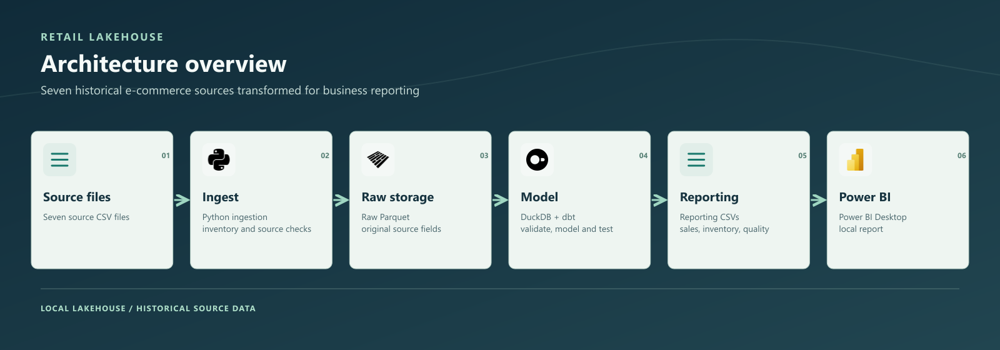
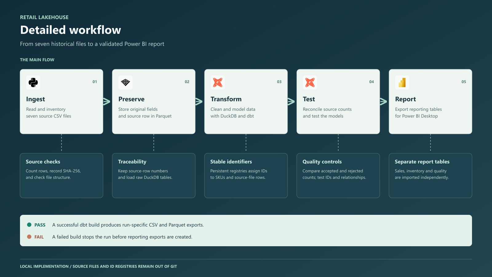

# E-commerce architecture

This local project processes seven historical e-commerce files through Python, Parquet, DuckDB and dbt. It produces separate reporting outputs for a local Power BI report. The report imports sales, inventory and quality tables separately; it is not a connected star schema.

## High-level overview

## Detailed local flow

The diagram shows the primary processing path, registry inputs, quality checks, and the pass-or-fail decision before reporting exports.

Product IDs are reused for known SKUs. Source-row IDs identify a specific file hash and row position; they are not stable business transaction IDs across changed files. The sources have different grains, and the price and warehouse sheets do not establish order-level profit. See [lakehouse setup](../lakehouse/README.md) and the [data model](../lakehouse/DATA_MODEL.md).
