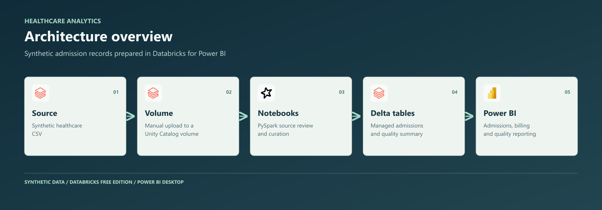
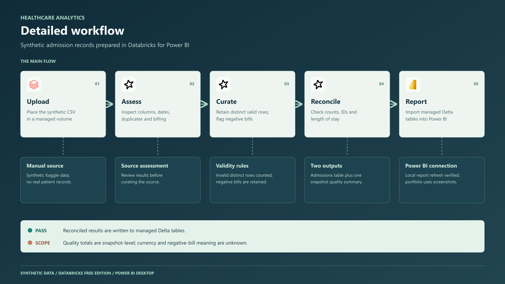

# Healthcare analytics architecture

The current demonstration uses a **synthetic** admissions dataset, Databricks Free Edition, PySpark and Power BI Desktop. The project owner verified the source reconciliation and a Power BI refresh. The Databricks-connected working report is kept locally; the portfolio offers screenshots and a separate downloadable workbook with a locally reconstructed fixed snapshot.

## High-level overview

## Detailed Databricks and reporting flow

The visual summarizes the main processing steps and the checks or limitations that matter at each stage.

The curation notebook counts invalid distinct rows without creating a record-level cloud quarantine.

The quality summary is separate and is not a filterable encounter-level audit. Negative bills are retained for review; their meaning and the billing currency are unknown. The hash identifies a distinct source row in this exercise, not a patient or a durable business encounter. The current cloud report is not a connected star schema. See the [Databricks guide](../databricks/README.md).

The source does not establish patient identities or billing currency; the report does not establish real-world clinical outcomes. See the [project README](../README.md) for source assessment, modeling rules, setup, and limitations.
