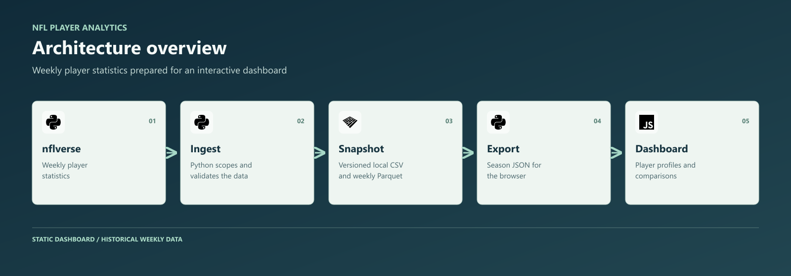
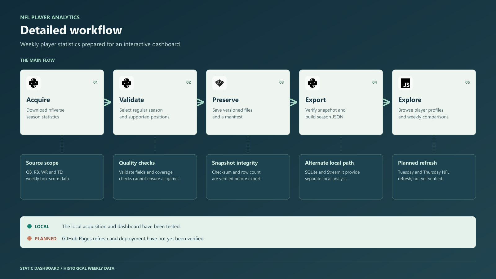

# NFL analytics architecture

The project uses nflverse weekly **box-score** player statistics, not live scores or Next Gen Stats tracking data. Local acquisition and the interactive static dashboard have been tested. A shared GitHub Pages refresh workflow is prepared but has not yet been verified on GitHub.

## High-level overview

## Detailed implementation and planned publication

The visual summarizes the main processing steps and the checks or limitations that matter at each stage.

The prepared daily workflow preserves the last validated NFL snapshot on non-refresh days or when a replacement fails validation. If the published baseline cannot be safely read, or the stock build fails, the combined deployment stops. The local export verifies snapshot checksums; the GitHub refresh independently validates the download and checks coverage. These checks do not guarantee that every game or later correction is present. See the [project README](../README.md) and [model documentation](../model/README.md).
