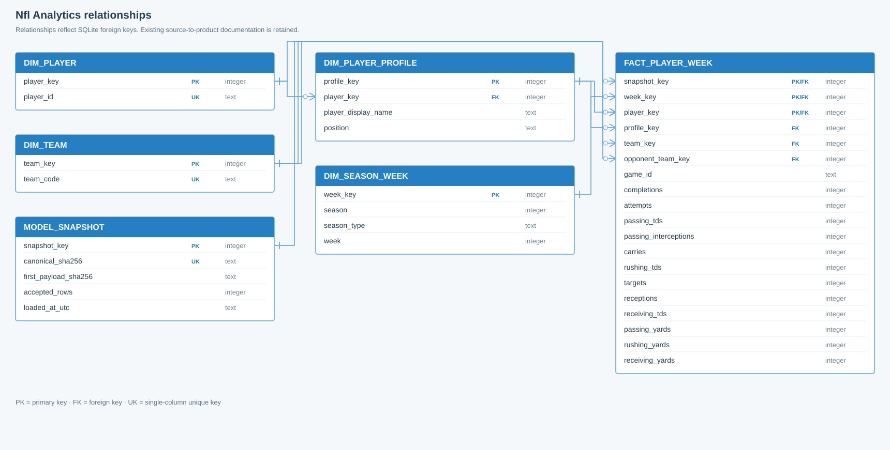
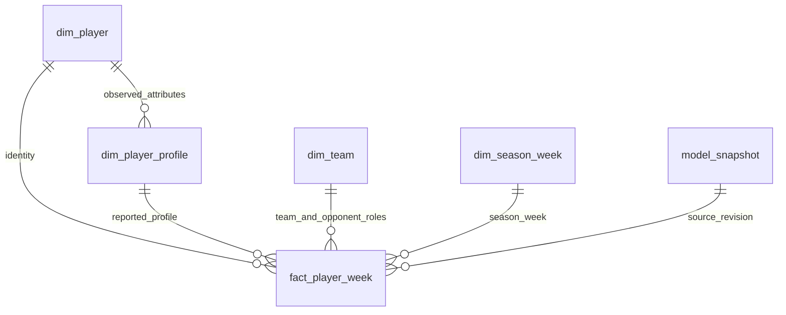

# NFL player-week dimensional model

Status: local SQLite model implemented for the Streamlit application. The static website reads exported JSON rather than this database. Existing snapshot checksum validation still runs before the model is built. The Streamlit application makes no network calls at startup; a separate CLI can persist a local database.

## Follow the source into the model

The [source-to-target mapping](source-to-target.md) traces every player-week field into identities, observed profiles, season/week references, team roles, and fact measures. The [complete dictionary](data-dictionary.md) lists every modeled and reporting-view column, type, nullability, key, unique constraint, and relationship. The [worked example](sample-walkthrough.md) shows a compact selection of real observations and one player's team changes without changing player identity.

The [detailed diagram](model.svg) combines source fields, transformation steps, full physical tables, relationship cardinalities, and reporting outputs. Its authoring script is kept locally and is not needed to view the diagram or run the dashboard. The example is a subset with its own analytical snapshot, not a replacement for the full local dataset.

## Grain and keys



**One fact represents one player in one regular-season week of one season, within one source snapshot.** The unique key is `(snapshot_key, week_key, player_key)`. This follows the validated source contract; it is not a play, team-game, roster, or tracking-data fact.

| Table | Purpose and key |
|---|---|
| `fact_player_week` | Weekly offensive counts and yardage, with game ID and player, profile, week, team, opponent, and snapshot keys |
| `dim_player` | Stable player identity: integer surrogate key and unique source player ID |
| `dim_player_profile` | Observed name and position for a player; unique player/name/position combination |
| `dim_team` | Unique source team code; role-played as player team and opponent |
| `dim_season_week` | Unique season + season type + week; REG weeks 1–18 under the existing contract |
| `model_snapshot` | Canonical normalized-content hash, first payload hash, accepted-row count, and UTC load time |

Player identity is independent of team. Team membership belongs on the weekly fact: a traded player's production remains associated with the team reported for that week. Profile observations preserve changes in name or position without overwriting earlier facts. These are observed attribute combinations, not a complete effective-dated Type 2 dimension or roster history. The composite profile/player relationship prevents attaching another player's profile to a fact.

`game_id` remains a degenerate identifier on the fact. There is no game dimension with invented kickoff dates, venues, scores, or home/away classifications. The current source contract does not include those attributes. A schedule source could support a proper game dimension later. NFL season/week is a business calendar and must not be treated as ISO calendar week.

[View the model diagram](model.svg).



## Measures and query behavior

Counts and yardage are stored as integers; negative yardage remains valid. Completion and reception constraints match the source validator. Additive statistics can be summed across compatible player-week observations in **one selected snapshot**. Do not sum across source revisions, which repeat observations.

Passing and receiving yards describe overlapping aspects of the same plays; adding them as a combined offensive total double counts production. Full-team statistics cannot be inferred from the scoped QB/RB/WR/TE rows or from a workload-qualified cohort. Player counts require distinct player IDs. Observed weeks count records, not roster-confirmed games played.

Efficiency and catch/completion rates are non-additive: sum numerators and denominators before dividing. Zero denominators return NULL. `v_player_season_totals` demonstrates these SQL calculations; `v_player_week` reconstructs the normalized source schema through dimension joins. Existing dashboard cohort calculations continue to use the validated aggregation functions, now over model-derived observations. SQL filters are also available through `read_snapshot` for team, position, season, and week bounds.

The SQL season view includes the entire selected snapshot. Dashboard filters and workload thresholds define a potentially smaller cohort; apply those filters before aggregation when comparing SQL with a dashboard. Latest team labels in the dashboard reflect the latest selected observation, while the fact table retains all team history in scope.

## Loading, revisions, and reconciliation

The existing validator first selects REG QB/RB/WR/TE records, reports exclusions, and rejects invalid in-scope rows. A canonical hash covers the sorted normalized rows. Equivalent accepted content reuses a snapshot even if input order or line endings change; changes to excluded rows alone do not create a new analytical revision. The first payload hash describes the first input loaded, not every ingestion attempt. Source URLs and retrieval metadata remain in the existing ingestion manifests rather than being inferred for uploads.

Changed accepted statistics create a separate snapshot, preserving previous results. Always choose a snapshot explicitly; there is no automatic latest-revision selector in the model. Snapshot, dimensions, and facts load in one transaction. The loader compares joined row counts and every additive statistic with the normalized source, then checks foreign keys before committing. Failed loads roll back all new rows.

The reviewed 2025 snapshot retained **6,037 player-weeks, 610 distinct players, and weeks 1–18** after dimension joins. Local source snapshots are excluded from Git; counts may change with source revisions. Tests compare every reconstructed field, verify SQL receiving efficiency against the Python reference, and exercise trades, profile revisions, multiple seasons, duplicates, orphans, negative yardage, NULL rates, and rollback.

## Reproduce locally

From the nfl-analytics directory, with dependencies installed, first run `python ingest.py --season 2025` to create the local snapshot. Then select the CSV path recorded in `data/current_2025.json`:

```powershell
$snapshot = Get-Content data/current_2025.json | ConvertFrom-Json
python warehouse.py --input (Join-Path data $snapshot.normalized_path) --season 2025 --database results/nfl-model.sqlite
python -m unittest discover -s tests -v
```

The generated results directory is ignored by version control. No AWS deployment, new download, schedule enrichment, or Next Gen Stats ingestion is implied by this model.

[Schema and views](schema.sql) | [SQL examples](queries.sql) | [Loader](../warehouse.py) | [Source attribution](../NOTICE.md)
