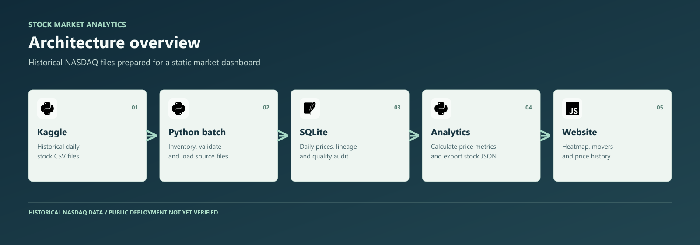
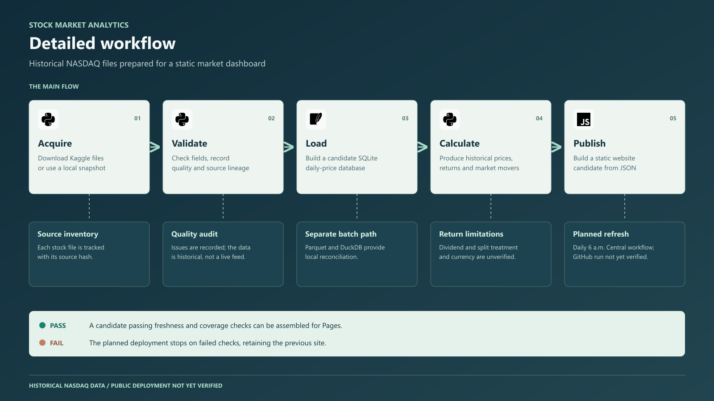

# Stock analytics architecture

The project processes a historical Kaggle snapshot of NASDAQ stock files into an interactive, static website. It is not a live feed, and the currency and dividend/split adjustment treatment remain unverified. A full local acquisition and rebuild were tested; GitHub deployment and scheduled refresh have not yet been verified.

## High-level overview

## Detailed batch and planned publication

The visual summarizes the main processing steps and the checks or limitations that matter at each stage.

The planned shared workflow validates market date, symbol counts and coverage before assembling the portfolio with stock and NFL data. A failed check stops deployment and preserves the previously published site.

The refresh creates a separate full rebuild; its database IDs are not guaranteed to remain stable between snapshots. The Parquet and DuckDB work is a separate locally verified batch path, not a required step in the scheduled website build. GitHub scheduling can be delayed and the upstream dataset might not yet be updated. Attribution does not resolve the dataset's unclear redistribution terms. See the [project README](../README.md) and [business metrics](business-metrics.md).
