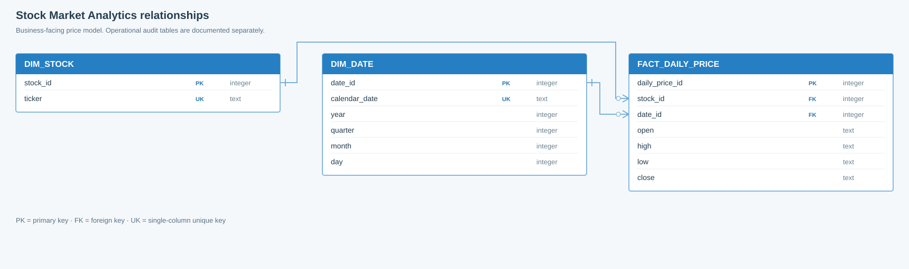

# Stock price data domain

The local SQLite build implements the three business-facing tables shown below. Download history and file-level audit belong in the separate operational layer. Incremental updates and historical corrections are not implemented.

The daily-price product has **one observation per stock and date**, enforced by a unique `(stock_id, date_id)` constraint. Each table has an auto-incrementing surrogate `_id`. The SQLite database must be retained and backed up to keep assigned identifiers; the current build refuses to overwrite it. Ticker is the source's observed label, not a verified permanent security identifier; symbol changes and reuse need further research. SQLite stores prices as decimal text to preserve input precision.

The separate [pipeline audit](pipeline-audit.md) describes source lineage, quality findings, and the limits of the current refresh process. The [daily-price mapping](mappings/fact_daily_price.md) documents field-level quality rules.

The reporting export implements returns and daily-to-weekly or monthly summaries at their own grains. See the [mappings](mappings/), [source assessment](source-assessment.md), and [business metrics](business-metrics.md).
