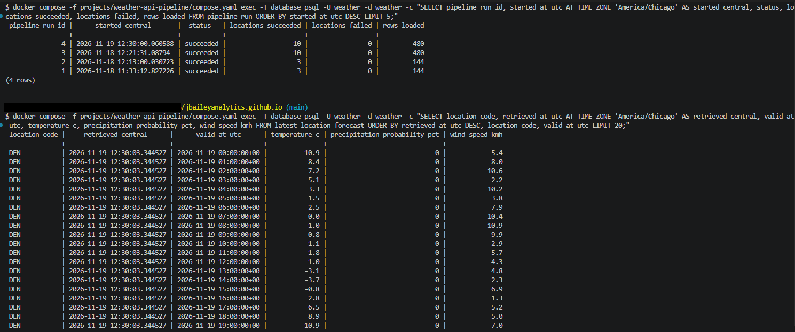
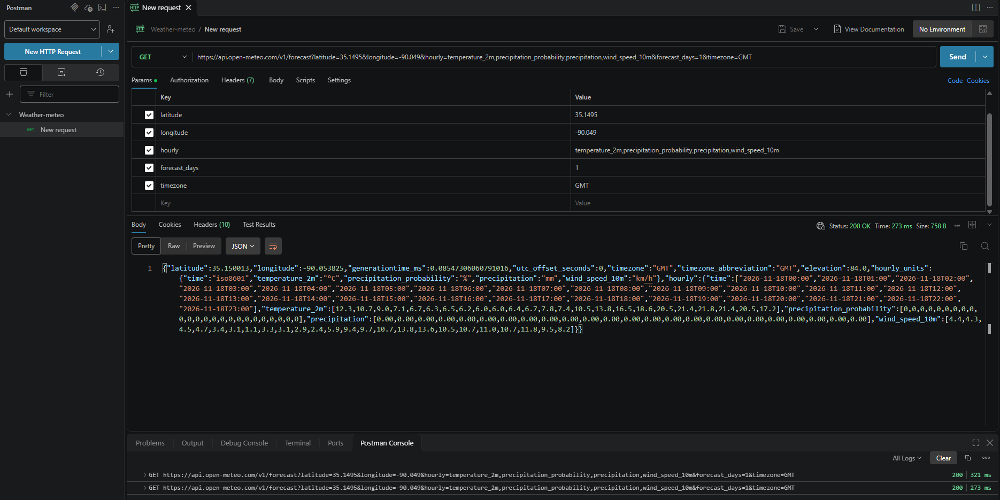

# Weather API Data Pipeline

A scheduled data pipeline that collects hourly weather forecasts for ten fictional distribution locations, validates the API responses, and stores queryable forecast snapshots in PostgreSQL.

**Stack:** Python · REST API · PostgreSQL · Docker Compose · SQL

**Demonstrates:** API integration, scheduled execution, schema design, data validation, transactional loading, run tracking, and safe replay.

For a read-only inspection of a local API capture, see the [source assessment notebook](notebooks/source_assessment.ipynb).

```text
Daily schedule → Open-Meteo API → Python validation → PostgreSQL → SQL queries
                                      ↓
                             Capture and run tracking
```

The schedule, database, and pipeline run locally. Forecast locations are fictional planning points; this project does not claim actual operational impacts or a production deployment.

## Objective

Collect weather forecasts for a small set of fictional distribution locations, validate and store the responses, and make the results available for planning staffing and delivery operations. The project should demonstrate the engineering lifecycle, including recovery from failed calls and safe reruns, rather than rely on a dashboard alone.

## Current status

Docker Compose runs PostgreSQL and a daily scheduler. A PostgreSQL run record shows a successful ten-location run at 12:30 p.m. Central on November 19, 2026, matching the configured daily schedule. An earlier ten-location manual run and three-location timed verification also succeeded. Integration tests use a disposable database to verify partial failure, recovery, constraints, replay behavior, database unavailability, and overlap protection. This is a local prototype; cloud deployment and external alerting are not implemented.

| Verified example | Result |
| --- | --- |
| Locations processed | 10 of 10 |
| Forecast records loaded | 480 total; 48 per location |
| Automated checks | 11 tests passed |
| Scheduled-time run | November 19, 2026, at 12:30 p.m. Central; 10 succeeded, 0 failed |

These are local point-in-time results, not ongoing uptime, forecast accuracy, or business outcomes. The database screenshot records the run time and result but does not by itself identify the trigger. See the [case study](../../case-studies/weather-api-pipeline.html) and [verification evidence](docs/verification.md).

### Local run and stored forecasts

The following terminal screenshot shows the run history query and sample Denver forecast rows retrieved from PostgreSQL. The successful November 19 run started at the configured local schedule and recorded 480 loaded rows across ten locations. The forecast sample shows 20 rows, not the complete output.

[](../../images/projects/weather-scheduled-run.png)

## API exploration and validation

A manual request made with Postman in VS Code returned a successful Memphis forecast response. The request and response show the coordinates, requested weather variables, returned units, and hourly arrays. This screenshot documents manual source inspection; the automated pipeline uses a two-day forecast and its run evidence is reported separately.

[](../../images/projects/weather-postman-request.png)

## Engineering decisions

- **Preserve forecast snapshots:** each retrieval has its own capture token; a later retrieval is not treated as the same forecast run. Retrieval time is not a verified provider issue time.
- **Make retries safe:** replaying the same capture does not duplicate rows, while a token reused with different data is rejected.
- **Keep failures visible:** batch and location outcomes are recorded independently, and a PostgreSQL advisory lock prevents overlapping batch runs.
- **Validate before loading:** check response units, ordered timestamps, aligned arrays, value types, and plausible probability and nonnegative measurements. Null values remain null.

- [Architecture and engineering decisions](docs/architecture.md)
- [Source assessment](docs/source-assessment.md)
- [Project scope and decisions](docs/project-scope.md)
- [Data model and field transformations](docs/data-model.md)
- [Verification evidence and limits](docs/verification.md)
- [Project structure](docs/project-structure.md)

## Run the manual inspection

With Python 3.10 or newer and internet access, run from the portfolio root:

```powershell
python projects/weather-api-pipeline/pipelines/inspect_forecast.py --location CHI
python -m unittest discover -s projects/weather-api-pipeline/tests -v
```

Ten fictional planning locations are configured in `config/locations.example.json`: Chicago (CHI), Dallas (DFW), Atlanta (ATL), Memphis (MEM), Louisville (SDF), Los Angeles (LAX), Newark (EWR), Seattle (SEA), Miami (MIA), and Denver (DEN). The command requests two days of hourly forecasts, validates and summarizes the response, and does not save it or update a database. All times are UTC; the full response may include hours earlier than the retrieval time because the requested horizon begins at the start of the current UTC day. This inspection uses Python's standard library; PostgreSQL loading additionally uses `psycopg`.

## Start the daily schedule

For a fresh checkout, first copy `.env.example` to `.env` in this project and replace the example password with a unique one. The filled-in `.env` is ignored by Git. From the portfolio root in PowerShell, start Docker Desktop, then run:

```powershell
docker compose -f projects/weather-api-pipeline/compose.yaml up -d database
docker compose -f projects/weather-api-pipeline/compose.yaml exec -T database psql -v ON_ERROR_STOP=1 -U weather -d weather -f /app/migrations/002_run_tracking.sql
docker compose -f projects/weather-api-pipeline/compose.yaml --profile scheduler up -d --build scheduler
docker compose -f projects/weather-api-pipeline/compose.yaml logs --tail 20 scheduler
```

The scheduler runs every day at **12:30 p.m. Central time**, automatically accounting for daylight saving time. Set `WEATHER_RUN_LOCAL=HH:MM` in the local `.env` file to change the time (24-hour Central time), then rebuild and recreate the scheduler with the start command. The former `WEATHER_RUN_UTC` setting is no longer used. Both the scheduler and database use Docker's `unless-stopped` restart policy. Docker Desktop and the computer must be running for scheduled execution; missed runs are not backfilled. A PostgreSQL advisory lock skips overlapping batch runs.

All ten location codes listed above are available. Rebuild and recreate the scheduler after changing its packaged location configuration. If `docker` is not recognized in the current terminal, open a new terminal after installation or add Docker Desktop's `resources\bin` directory to that session's PATH.

The local `.env` file contains the generated database password and is excluded from Git. Keep it private and back it up securely with the project database if you need to restore the setup. PostgreSQL is accessible to the pipeline over Docker's private network; no host database port is exposed. The first start initializes the schema in a named Docker volume. Initialization scripts do not rerun on an existing volume; subsequent schema changes require a migration. Stop the schedule and database with `docker compose -f projects/weather-api-pipeline/compose.yaml stop scheduler database`; do not remove its volume if you want to retain data.

Never commit the filled-in `.env` file. The ignored local captures and database volume are not part of the checkout.

## Run and inspect manually

Run all configured locations immediately, without changing the schedule:

```powershell
docker compose -f projects/weather-api-pipeline/compose.yaml run --build --rm --entrypoint python pipeline pipelines/scheduler.py --once
docker compose -f projects/weather-api-pipeline/compose.yaml exec -T database psql -U weather -d weather -c "SELECT status, locations_succeeded, locations_failed, rows_loaded FROM pipeline_run ORDER BY started_at_utc DESC LIMIT 5;"
docker compose -f projects/weather-api-pipeline/compose.yaml exec -T database psql -U weather -d weather -c "SELECT location_code, valid_at_utc, temperature_c, wind_speed_kmh FROM latest_location_forecast WHERE valid_at_utc >= CURRENT_TIMESTAMP ORDER BY location_code, valid_at_utc LIMIT 10;"
```

An individual location can still be fetched with `docker compose -f projects/weather-api-pipeline/compose.yaml run --rm pipeline --location CHI`. Batch runs write run and location-level outcomes to PostgreSQL and structured events to the scheduler logs. A database outage before a run can be recorded is visible only in container logs. At the next successful lock acquisition, interrupted runs left in `running` are marked failed. The scheduler attempts the next scheduled day; it does not automatically retry failed locations or missed runs. Retained captures support manual replay after a load failure.

Each successful fetch is saved under `results/captures/` before the database load, with a capture token. If a load fails, replay the **same** capture, using the container path printed by the original run:

```powershell
docker compose -f projects/weather-api-pipeline/compose.yaml run --rm pipeline --snapshot /app/results/captures/<capture-token>.json
```

Identical replays are no-ops; a reused token with different snapshot data is rejected. A new fetch receives a new token and can contain a revised forecast for the same future hour. Capture files and the database volume are separate and should both be retained if replay and lineage are needed. The capture files contain publicly requested forecasts, not an authenticated API token.

## Tests and limits

Run unit and integration tests in a disposable PostgreSQL container:

```powershell
docker compose -f projects/weather-api-pipeline/compose.yaml --profile test run --build --rm integration-tests
docker compose -f projects/weather-api-pipeline/compose.yaml --profile test stop test-database
```

The test database uses temporary storage and is discarded when stopped; it is separate from the project database. [SQL examples](sql/) include the latest forecast and run history. Forecasts are provider model estimates, not observations or proof of operational disruption. API availability, forecast accuracy, retention limits, external alerting, automatic backfill, and cloud deployment are outside the current implementation. A timer-triggered run was verified separately against the disposable database; check scheduler logs and run history when validating a new local setup.

## Source and attribution

Forecast data is provided by [Open-Meteo](https://open-meteo.com/); see its [API documentation](https://open-meteo.com/en/docs), [licence](https://open-meteo.com/en/licence), and [terms](https://open-meteo.com/en/terms). The provider describes the free API as noncommercial. Credentials, local captures, and database data are excluded from this repository.
