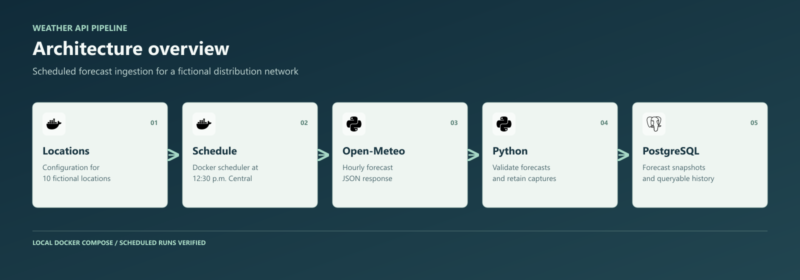
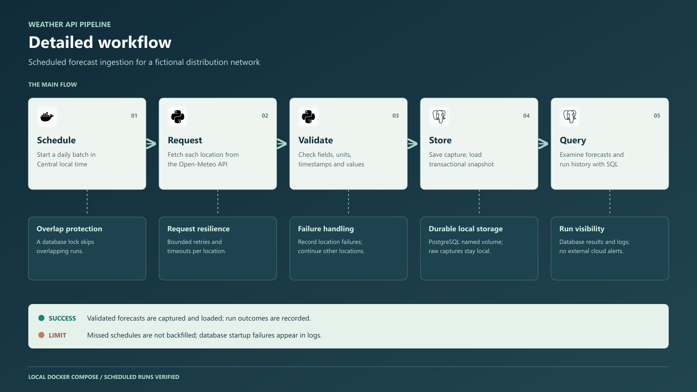

# Pipeline architecture

## High-level overview

## Detailed local flow

The visual summarizes the main processing steps and the checks or limitations that matter at each stage.

A saved capture has a replay token; retries can reuse the capture rather than create a second snapshot. An overlapping batch is skipped, and location failures are recorded while other locations continue.

The Python API fetch and validation, saved raw capture, and transactional PostgreSQL load are implemented using Docker Compose. A batch processes all configured locations and records run and location outcomes. The scheduler is configured for 12:30 p.m. Central, including daylight saving time; a PostgreSQL advisory lock skips overlapping batch runs. A ten-location database run on November 19 began at the configured time; the database record alone does not identify its trigger. The database uses a persistent named volume and is not exposed on a host port. Identical capture replay, conflicting-replay rejection, failure recovery, and overlap protection were checked locally using an isolated test database. No cloud deployment or external alerts are implemented.

The [data model](data-model.md) uses a retrieval snapshot and hourly rows. The provider response inspected did not establish a forecast issue time, so retrieval time is not labeled as one. Forecasts and historical estimates require separate, explicitly labeled grains. Each capture is retained before loading, and its UUID is reused for a retry; distinct retrievals retain separate snapshots. Run outcomes are queryable in PostgreSQL and logs, but database unavailability before auditing is visible only in container logs. Missed schedules are not backfilled; formal migrations beyond the additive setup script and external monitoring remain future work.
