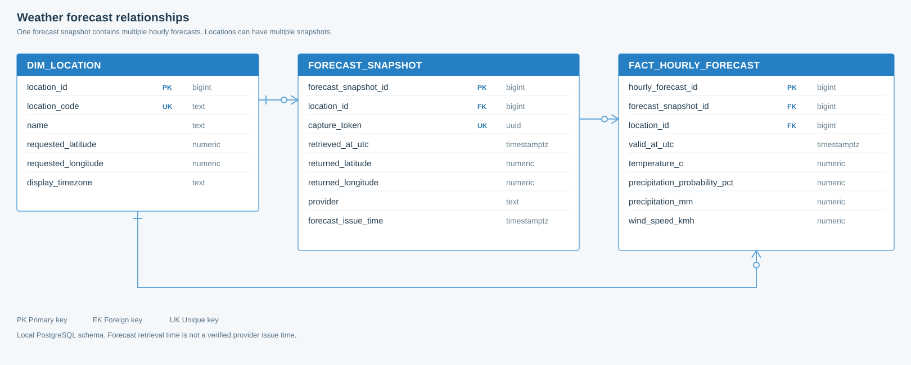

# Weather forecast data model

The local PostgreSQL model turns each API response into related tables. It is implemented locally in Docker and is not a cloud deployment. The ten configured city locations are fictional planning points, not actual facilities.

**Key:** PK = primary key, FK = foreign key, UK = unique key. A crow's foot indicates the many side of a relationship. The diagram shows the business-facing relationships.

**Grain:** one hourly forecast for one location and valid time within one retrieved snapshot. The snapshot is one response retrieved for one configured location. A new retrieval may contain different forecasts for the same future hour, so those records are not automatically duplicates across snapshots. A retrieval time is not a provider-issued model-run time; `forecast_issue_time` remains null unless a reliable source is verified. It is not an observation of actual weather.

All three tables have generated integer surrogate IDs. A unique capture token identifies a retained acquisition for safe retries. The fact has a unique `(forecast_snapshot_id, valid_at_utc)` and a composite foreign key ensuring its location agrees with the snapshot's location. The database volume must be retained for IDs to persist.

The requested coordinates identify the planning location; the returned coordinates identify the provider's grid location. Both matter because they can differ. Timestamps are stored in UTC, and the sample query converts valid times using the location's IANA timezone. Separate operational tables record batch runs and location-level outcomes; they are not shown in this business-facing diagram. Detailed field-level quality event storage is not implemented.

## Fields and transformations

### Location

`location_code` and `name` come from configuration. Requested latitude and longitude are numeric coordinates within geographic bounds. `display_timezone` is an IANA timezone for presentation and is validated during loading. These examples use city-center approximations, not real facilities. A change to an existing location's configuration is rejected pending an explicit history policy.

### Forecast snapshot

Resolve `location_id` from configuration. Generate and persist a `capture_token` UUID once per acquisition attempt and reuse it when retrying that database load. Record an aware UTC `retrieved_at_utc` after retrieval, the provider as `Open-Meteo`, and the response's numeric, geographically valid `latitude` and `longitude` as the returned coordinates. Leave `forecast_issue_time` null unless a reliable provider issue time is established. A raw response and location configuration are saved in the capture file before loading; full request parameters are not recorded in the capture. Batch and location outcomes are recorded separately in operational tables.

### Hourly forecast

Resolve `forecast_snapshot_id` and `location_id`, ensuring the two references describe the same location. Parse `hourly.time` as UTC from the zero-offset response; require unique, ordered, consecutive hours. The four measurements are:

| Field | API field | Meaning and initial validation |
| --- | --- | --- |
| `temperature_c` | `temperature_2m` | Finite number in °C or null; air temperature at 2 m. |
| `precipitation_probability_pct` | `precipitation_probability` | Finite number from 0 to 100 or null; probability of precipitation exceeding 0.1 mm in the preceding hour. |
| `precipitation_mm` | `precipitation` | Nonnegative finite number in mm or null; forecast precipitation for the preceding hour. |
| `wind_speed_kmh` | `wind_speed_10m` | Nonnegative finite number in km/h or null; wind speed at 10 m. |

The normalizer rejects missing or unexpected units, malformed or unequal arrays, nonconsecutive hours, nonfinite values, and out-of-range probabilities or negative precipitation or wind. It preserves nulls rather than converting them to zero. These checks do not prove forecast accuracy. The [PostgreSQL schema](../sql/schema.sql) was initialized locally; identical and conflicting capture replays were checked against the running database.
